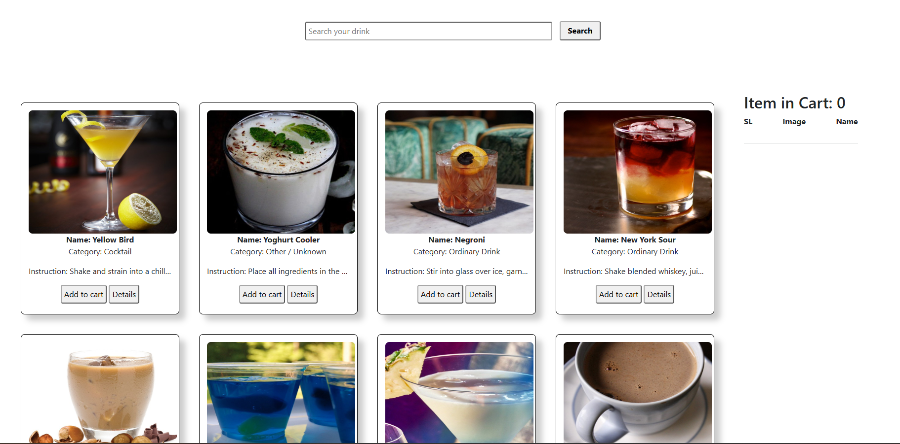
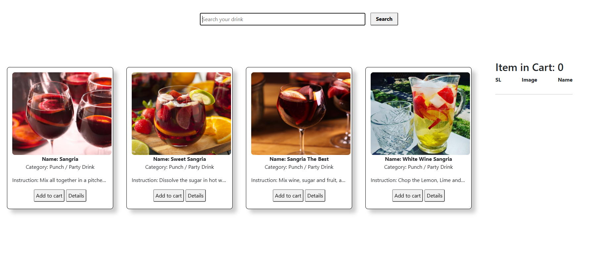
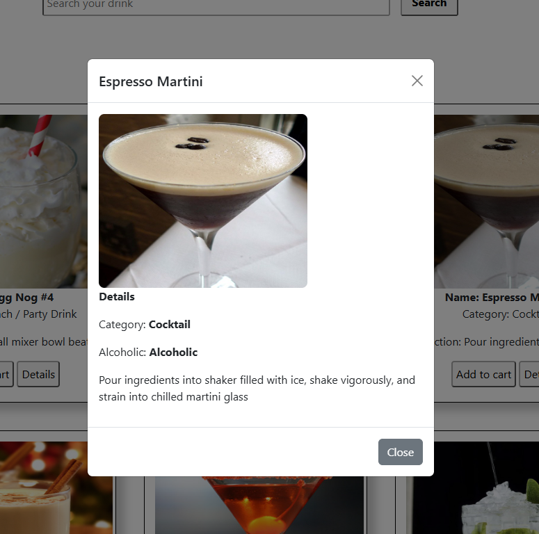
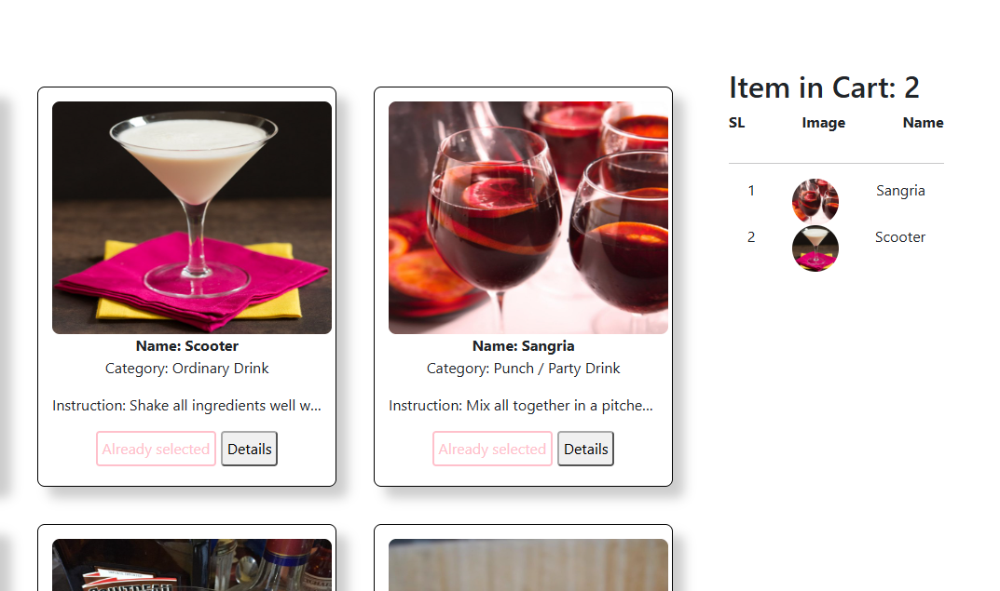

# Drink Lover

Drink Lover is a beginner-friendly JavaScript practice project for exploring cocktail recipes using a public API. It was built to practice fetching data, manipulating the DOM, handling user events, and displaying information dynamically without a frontend framework.

## Key Features

- **Explore drinks:** Load cocktail cards from [TheCocktailDB API](https://www.thecocktaildb.com/api.php), including images, names, categories, and shortened instructions.
- **Search drinks:** Search by name using the Search button or Enter key.
- **View details:** Open a Bootstrap modal with the drink image, category, alcoholic classification, and instructions.
- **Select drinks:** Add drinks to a sidebar selection list from the initial drink cards, with a maximum of seven selections.
- **Basic feedback:** Display an alert when a search finds no matching drinks or the selection limit is reached.

## Screenshots

### Drink Listing

The main page displays drinks in a card layout alongside a selected-items panel.



### Search Results

Search for a drink by name to display matching results.



### Drink Details

The Details button opens a modal showing additional information and preparation instructions.



### Shopping Cart

Selected drinks are added to the shopping cart and displayed with their serial number, thumbnail, and drink name. The cart also keeps track of the total number of selected items.



## Tech Stack

- **HTML5** - Page structure
- **CSS3** - Custom card and layout styling
- **JavaScript (Vanilla JS)** - Fetch API, DOM manipulation, and event handling
- **Bootstrap 5** - Base styling and modal component (via CDN)
- **TheCocktailDB API** - Drink information

## Project Structure

```text
Drink-Lover/
├── index.html
├── style.css
├── script.js
├── docs/                     # Add this folder for screenshots
│   └── screenshots/
│       ├── drink-listing.png
│       ├── search-results.png
│       └── drink-details.png
└── README.md
```

## Getting Started

### Prerequisites

- A modern web browser
- An internet connection for API requests and Bootstrap CDN assets

### Run Locally

1. Clone the repository:

   ```bash
   git clone https://github.com/YOUR_USERNAME/YOUR_REPOSITORY.git
   ```

2. Open the project folder and launch `index.html` in your browser. You can also serve the folder with VS Code Live Server.

No npm installation or build step is required.

## API Reference

This project uses the public [TheCocktailDB API](https://www.thecocktaildb.com/api.php).

| Purpose                     | Endpoint                                                            |
| --------------------------- | ------------------------------------------------------------------- |
| Load drinks by first letter | `https://www.thecocktaildb.com/api/json/v1/1/search.php?f={letter}` |
| Search drinks by name       | `https://www.thecocktaildb.com/api/json/v1/1/search.php?s={name}`   |

The initial listing requests drinks for letters A-Z in randomized order. The implementation uses the public test API key `1`.

## How It Works

| File         | Responsibility                                                                                        |
| ------------ | ----------------------------------------------------------------------------------------------------- |
| `index.html` | Defines the search area, drink listing, selection panel, and Bootstrap modal.                         |
| `style.css`  | Styles the search controls, drink cards, selection panel, and images.                                 |
| `script.js`  | Fetches API data, renders cards, processes searches, opens the details modal, and handles selections. |

## Learning Objectives

This practice project focuses on JavaScript fundamentals: asynchronous `fetch()` requests, promises, arrays and loops, DOM updates, event listeners, template literals, and integrating a third-party API.

## Known Limitations and Future Improvements

- **Selection behavior:** The Add to cart button is wired on the initial drink listing, but not on search-result cards. There is no removal feature.
- **API loading:** Add loading indicators and error handling for failed requests.
- **Search feedback:** Replace browser alerts with inline messages and handle empty queries.
- **Performance:** Reduce the number of initial API requests and improve rendering efficiency.
- **Responsive design:** Improve the fixed-width layout for smaller screens.

## Contributing

Suggestions and improvements are welcome. Fork the repository, create a feature branch, and open a pull request.

## Author

**Md. Sazidul Islam**

- GitHub: [@sazidrafi](https://github.com/sazidrafi)
- LinkedIn: [Md. Sazidul Islam](https://www.linkedin.com/in/md-sazidul-islam39/)

---

_Built as a hands-on practice project while learning JavaScript and working with APIs._
